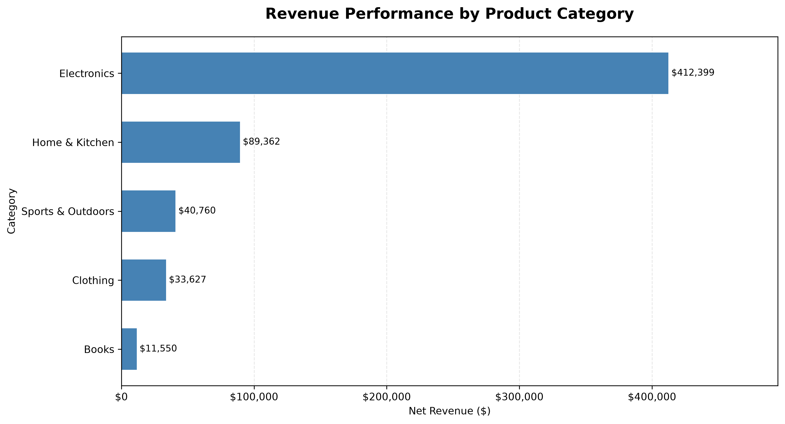
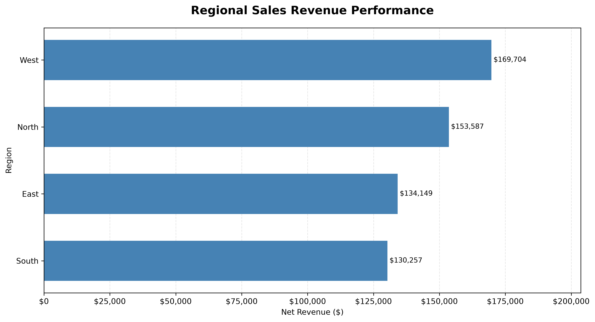
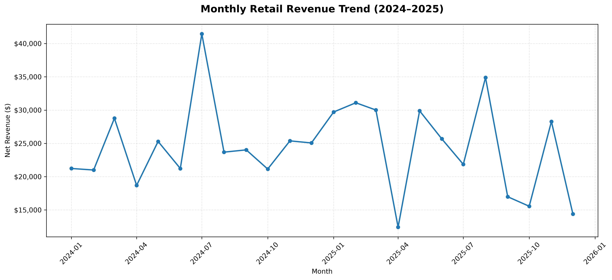
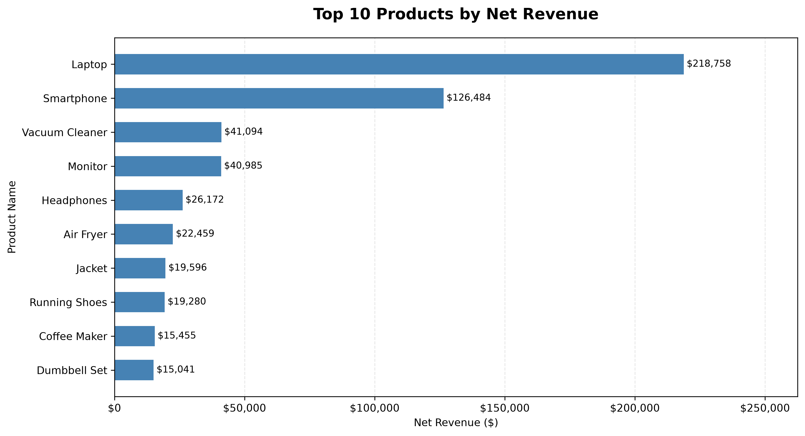
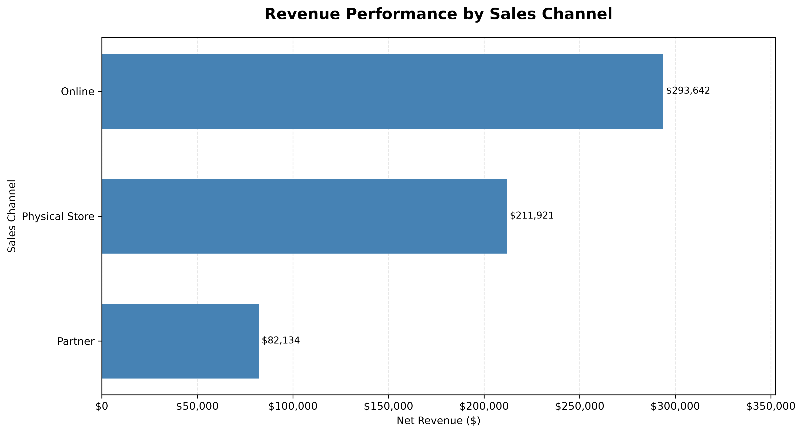

# Retail Sales Performance Analysis

[](https://mybinder.org/v2/gh/Arian858/retail-sales-performance-analysis/HEAD?urlpath=lab/tree/notebooks/retail_sales_analysis.ipynb)


A Python-based retail sales analytics project exploring revenue trends, product performance, regional sales distribution, customer purchasing patterns, and business KPIs using Pandas, NumPy, and data visualization.

---

## Project Overview

The **Retail Sales Performance Analysis** project demonstrates a structured approach to retail data analytics using Python.

It transforms synthetic retail transaction data into meaningful analytical insights through data preparation, exploratory analysis, statistical techniques, business performance indicators, and visualization.

The project also demonstrates professional Python development practices, including modular programming, automated testing, and reproducible environments.

## Business Objectives

The analysis addresses the following business questions:

- How much revenue does the business generate?
- Which product categories and individual products perform best?
- Which geographical regions contribute the most revenue?
- How does sales performance evolve over time?
- What are the customer purchasing patterns?
- Which sales channels and payment methods are most frequently used?
- How are discounts distributed across transactions?
- What statistical relationships exist between numerical sales variables?

## Key Features

- **Data Generation:** Reproducible synthetic retail transaction dataset.
- **Data Quality Assessment:** Validation of missing values, duplicates, numerical consistency, and financial calculations.
- **Exploratory Data Analysis:** Examination of transaction structures and statistical distributions.
- **Business KPIs:** Revenue, order volume, average order value, units sold, and customer metrics.
- **Product Analysis:** Category and individual product performance.
- **Regional Analysis:** Comparison of geographical sales performance.
- **Time-Series Analysis:** Annual, monthly, and quarterly revenue trends.
- **Customer Analysis:** Purchase frequency, repeat purchasing, and revenue contribution.
- **Channel Analysis:** Comparison of online, physical-store, and partner sales.
- **Statistical Analysis:** Pearson and Spearman correlations.
- **Visualization:** Business-oriented charts and graphical reporting.
- **Automated Testing:** Unit tests using Pytest.

## Technologies

| Technology | Purpose |
| --- | --- |
| Python | Core programming language |
| Pandas | Data manipulation and analysis |
| NumPy | Numerical operations |
| Matplotlib | Data visualization |
| Seaborn | Statistical visualization |
| Jupyter | Interactive analytical notebooks |
| Pytest | Automated testing |
| Git | Version control |
| GitHub | Project hosting |
| Binder | Reproducible cloud execution |

## Repository Structure

```text
retail-sales-performance-analysis/
│
├── data/
│   ├── raw/
│   │   └── retail_sales.csv
│   │
│   └── processed/
│       └── retail_sales_cleaned.csv
│
├── notebooks/
│   └── retail_sales_analysis.ipynb
│
├── src/
│   ├── __init__.py
│   ├── generate_data.py
│   └── sales_analysis.py
│
├── tests/
│   └── test_sales_analysis.py
│
├── reports/
│   ├── executive_summary.md
│   └── figures/
│
├── requirements.txt
├── .gitignore
└── README.md
```

## Dataset Description

The project uses a reproducible synthetic retail transaction dataset containing 1,500 transactions across the 2024–2025 period.

The dataset includes:

- Transaction identifiers and dates.
- Customer identifiers.
- Geographical information.
- Sales channels.
- Product names and categories.
- Unit prices and quantities.
- Discount percentages.
- Gross revenue, discount amounts, and net revenue.

The dataset is generated using a fixed random seed to support reproducibility.

**Important:** The dataset is synthetic and does not represent actual company transactions or real customer behavior.

## Analytical Visualizations

The project generates standalone analytical charts in `reports/figures/`.

### Product Category Performance



### Regional Sales Performance



### Monthly Revenue Trends



### Top Performing Products



### Sales Channel Performance



## Getting Started

### Option 1: Run Online with Binder

Click the **Launch with Binder** button at the top of this repository.

Binder creates a temporary cloud environment and opens the main analytical notebook in JupyterLab.

No local Python installation is required.

### Option 2: Run Locally with Visual Studio Code

**Prerequisites**

- Python 3
- Visual Studio Code
- Microsoft Python extension
- Microsoft Jupyter extension

**1. Clone the repository**

```bash
git clone https://github.com/Arian858/retail-sales-performance-analysis.git

cd retail-sales-performance-analysis
```

**2. Create a virtual environment**

```bash
py -m venv .venv
```

**3. Activate the environment on Windows**

```powershell
.\.venv\Scripts\Activate.ps1
```

**4. Install dependencies**

```bash
python -m pip install -r requirements.txt
```

**5. Generate the dataset**

```bash
python src/generate_data.py
```

**6. Open the project in Visual Studio Code**

Open `notebooks/retail_sales_analysis.ipynb`, select the `.venv` Python kernel, and execute the cells sequentially.

## Automated Testing

The project includes automated tests for reusable analytical functions and data validation.

Run the test suite from the project root:

```bash
python -m pytest -v
```

## Project Reports

The executive summary is available here:

[View Executive Summary](reports/executive_summary.md)

## Analytical Limitations

- The transaction dataset is synthetically generated.
- Customer identifiers and purchasing patterns do not represent real customer behavior.
- Regional and sales-channel assignments are simulated.
- Correlation does not establish causation.
- Profitability cannot be calculated because product costs and operating expenses are not included.
- Discount effectiveness cannot be established through the randomly assigned discount rates.

The project is intended to demonstrate analytical techniques and reproducible Python development rather than provide real-world commercial forecasts.

## Project Status

Completed analytical implementation covering exploratory data analysis, business KPIs, product and regional performance, customer purchasing patterns, statistical analysis, visualization, and automated testing.

---

Developed as a practical Python data analytics portfolio project.

**Author:** [Arian858](https://github.com/Arian858)
